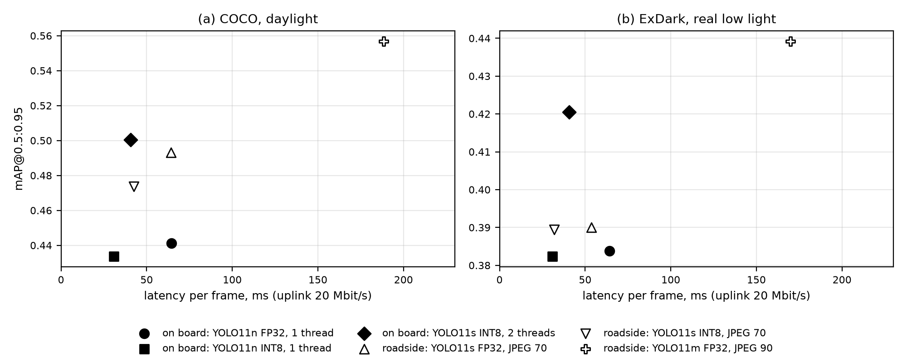
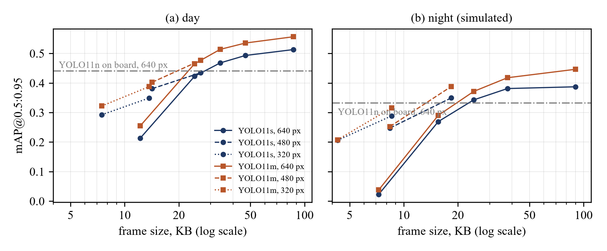
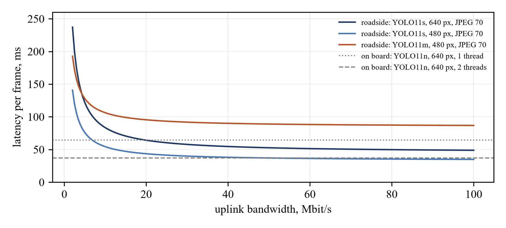

# edge-offload-detection

On board or at the roadside? Accuracy and latency of offloaded object detection for connected vehicles under frame compression and low light.

This repository has the code and all raw measurements for the paper by A. Mingazov and A. Andrianova (Kazan Federal University, 2026). A vehicle can run a light detector on its own computer or send a JPEG-compressed frame to a roadside unit with a heavier model. We measure what each choice costs in accuracy and latency, in daylight and in low light, with FP32 and INT8 models, on a CPU without a GPU.

## Setup
- COCO: the first 500 val2017 images that contain a person or a car (1921 people, 294 cars), plus a simulated low-light copy (linear light, x0.12, Poisson-Gaussian noise, fixed seed).
- ExDark: all 1096 test-split images with annotated people or cars (2235 people, 919 cars), real low-light photographs.
- Transmitted frame: longer side 640, 480 or 320 px, JPEG quality 10 to 90 (OpenCV).
- Models: YOLO11n, YOLOv8n, YOLO11s, YOLO11m (Ultralytics 8.4, COCO weights, no fine-tuning). YOLO11n and YOLO11s also in OpenVINO FP32 and INT8 (NNCF post-training quantisation, 300 calibration images that are not in the test set).
- Hardware: AMD Ryzen 9 7940HS, 32 GB RAM, CPU only. On-board computer emulated with 1 or 2 threads, roadside unit with 8.
- Latency: median per frame over 100 frames after 10 warm-up frames. Offloading = encode + size / bandwidth + decode + inference on the unit. Radio access delay and packet loss are not modelled.

## Main results
| Configuration | Latency, ms (20 Mbit/s, COCO / ExDark) | COCO day | ExDark (real low light) |
|---|---|---|---|
| On board: YOLO11n FP32, 1 thread | 64.4 | 0.441 | 0.384 |
| On board: YOLO11n INT8, 1 thread | 30.7 | 0.434 | 0.382 |
| On board: YOLO11s INT8, 2 threads | 40.6 | 0.500 | 0.420 |
| Roadside: YOLO11s FP32, JPEG 70 | 64.2 / 53.7 | 0.493 | 0.390 |
| Roadside: YOLO11s INT8, JPEG 70 | 42.5 / 32.0 | 0.474 | 0.389 |
| Roadside: YOLO11m FP32, JPEG 90 | 188.5 / 169.8 | 0.557 | 0.439 |

- Low light reduces accuracy of every model by 19-26 % and makes JPEG compression about twice as harmful. On real ExDark images YOLO11m loses 10 % at quality 70 and 40 % at quality 30.
- Under a limited uplink at night, reduce resolution, not quality: on ExDark, 320 px at quality 70 (7.4 KB) gives 0.336, while 640 px at quality 10 (7.0 KB) gives 0.056.
- INT8 speeds the models up by 2.3-3.0 times and costs at most 0.015 mAP. Quantised YOLO11s on two on-board cores is more accurate than offloading the same model and does not depend on the link.
- Offloading pays off only to a substantially heavier model (YOLO11m class), which needs an accelerator. An 8-thread CPU unit runs YOLO11s at about 23 fps in FP32 and 46 fps in INT8, enough for two or four vehicles at 10 fps.





## Files
- `prep.py`: COCO images, low-light copies, JPEG variants, sizes and encode / decode times.
- `run_acc.py`, `run_time.py <threads>`: accuracy (48 runs) and latency of the PyTorch models.
- `exdark.py prep <img_dir> <gt_dir> <imageclasslist.txt>` and `exdark.py acc`: ExDark test set and its 24 accuracy runs.
- `quant.py calib | export | acc | time <threads>`: calibration set, OpenVINO FP32 / INT8 export, accuracy and latency.
- `analyze.py`, `fig3.py`: tables, break-even bandwidth and figures.
- `results/`: all raw measurements in JSON.

## Run
```
pip install -r requirements.txt
# put yolo11n.pt, yolov8n.pt, yolo11s.pt, yolo11m.pt from the Ultralytics releases into this folder
python prep.py
python run_acc.py
for t in 1 2 4 8; do python run_time.py $t; done
python quant.py calib && python quant.py export && python quant.py acc
for t in 1 2 4 8; do python quant.py time $t; done
# ExDark: https://github.com/cs-chan/Exclusively-Dark-Image-Dataset (images and annotations)
python exdark.py prep <ExDark images> <ExDark_Annno> <imageclasslist.txt> && python exdark.py acc
python analyze.py && python fig3.py
```

## Limitations
ExDark is real low light but not a driving dataset, and the link is modelled only by bandwidth. Next steps: night driving data, 4G/5G latency traces, and cooperation between several vehicles and roadside units.
