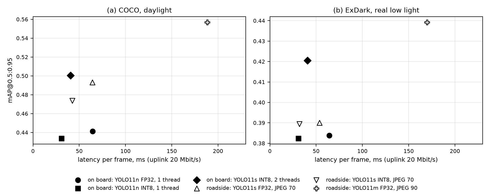
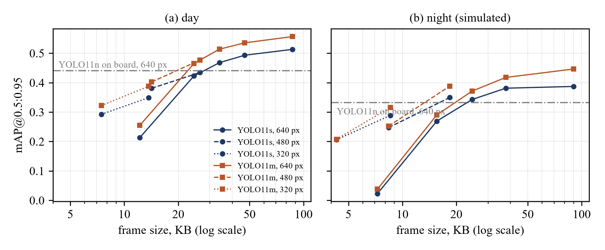
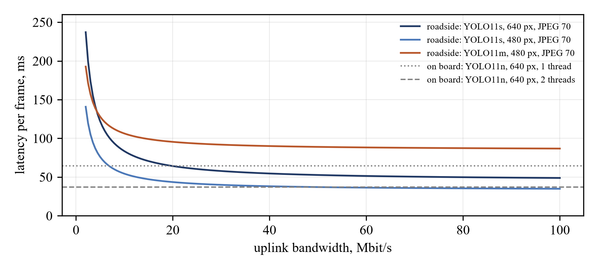

# edge-offload-detection

Cooperative computer vision in road infrastructure: evaluating on-board and server-side video processing.

This repository contains the experiment scripts and all 163 raw measurement records for the paper by A. A. Mingazov and A. A. Andrianova (Kazan Federal University, 2026). In road monitoring and intelligent transport systems (ITS), video from an edge/on-board camera can be processed locally on a CPU or compressed as JPEG and sent to a roadside server running a heavier model. We measure what each option costs in detection accuracy (mAP), latency, missed pedestrians and false alarms across original COCO, synthetically darkened COCO, and real low-light ExDark scenes in FP32 and INT8 on a CPU without a GPU.

## Setup
- COCO: the first 500 val2017 images containing a person or a car (1921 people, 294 cars), plus a synthetically darkened copy (linear light x0.12, Poisson-Gaussian sensor noise, fixed seed).
- ExDark: all 1096 test-split images with annotated people or cars (2235 people, 919 cars), real low-light photographs.
- Transmitted frame: longer side 640, 480 or 320 px, JPEG quality 10 to 90 (OpenCV, 9 settings).
- Models: YOLO11n, YOLOv8n, YOLO11s, YOLO11m (Ultralytics 8.4, COCO weights, no fine-tuning). YOLO11n and YOLO11s are also exported to OpenVINO FP32 and INT8 (NNCF post-training quantisation, 300 disjoint calibration images).
- Hardware: AMD Ryzen 9 7940HS, 32 GB RAM, CPU only. Local endpoint emulated with 1 or 2 threads, server node with 8 threads.
- Latency: median per frame over 100 frames after 10 warm-up frames. Server offloading latency is modelled as `L = t_encode + 8*S/B + t_decode + t_process`.

## Main results
| Configuration | Latency, ms (20 Mbit/s, COCO / ExDark) | COCO original | ExDark (real low light) |
|---|---|---|---|
| Local: YOLO11n FP32, 1 thread | 64.4 | 0.441 | 0.384 |
| Local: YOLO11n INT8, 1 thread | 30.7 | 0.434 | 0.382 |
| Local: YOLO11s INT8, 2 threads | 40.6 | 0.500 | 0.420 |
| Server: YOLO11s FP32, JPEG 70 | 64.2 / 53.7 | 0.493 | 0.390 |
| Server: YOLO11s INT8, JPEG 70 | 42.5 / 32.0 | 0.474 | 0.389 |
| Server: YOLO11m FP32, JPEG 90 | 188.5 / 169.8 | 0.557 | 0.439 |

- Low light reduces baseline detection accuracy by 19-26% and makes JPEG compression roughly twice as destructive. On real ExDark images YOLO11m loses 10% mAP at quality 70 and 40% at quality 30.
- Under a constrained uplink in dark scenes, reduce resolution, not JPEG quality: on ExDark, 320 px at quality 70 (7.4 KB) achieves 0.336 mAP, whereas 640 px at quality 10 (7.0 KB) drops to 0.056.
- OpenVINO INT8 quantisation speeds up single-thread inference by 2.29-2.95x with at most 0.015 mAP loss. Two-thread local YOLO11s INT8 (40.6 ms) outperforms compressed-frame offloading in both accuracy and latency without relying on the network link.
- Missed pedestrians (confidence 0.25, IoU >= 0.5) on ExDark: local YOLO11n FP32 misses 33.7% (TP 1482, FP 378, FN 753; Precision 79.68%, Recall 66.31%), server YOLO11s at JPEG 70 misses 34.5%, server YOLO11m at JPEG 90 misses 27.7%, and local YOLO11s INT8 misses 25.9% (TP 1657, FP 524, FN 578; Precision 75.97%, Recall 74.14%). Small bounding boxes (<64 px) are missed over 50% of the time from a single camera, motivating multi-camera cooperative perception.





## Files
- `prep.py`: COCO images, low-light copies, JPEG variants, file sizes and encode/decode times.
- `run_acc.py`, `run_time.py <threads>`: accuracy (48 runs) and latency (40 runs) of the PyTorch models.
- `exdark.py prep <img_dir> <gt_dir> <imageclasslist.txt>` and `exdark.py acc`: ExDark test set and its 24 accuracy runs.
- `quant.py calib | export | acc | time <threads>`: calibration set, OpenVINO FP32/INT8 export, 17 accuracy runs and 16 latency runs.
- `miss.py`: missed pedestrians, false positives, and breakdown by box height (<64 px vs >=64 px), `results/miss.json` (18 runs).
- `analyze.py`, `fig3.py`: summary tables, break-even bandwidth and figures.
- `results/`: all 163 raw configuration records in JSON.

## Run
```
pip install -r requirements.txt
# put yolo11n.pt, yolov8n.pt, yolo11s.pt, yolo11m.pt from Ultralytics releases into this folder
python prep.py
python run_acc.py
for t in 1 2 4 8; do python run_time.py $t; done
python quant.py calib && python quant.py export && python quant.py acc
for t in 1 2 4 8; do python quant.py time $t; done
# ExDark: https://github.com/cs-chan/Exclusively-Dark-Image-Dataset (images and annotations)
python exdark.py prep <ExDark images> <ExDark_Annno> <imageclasslist.txt> && python exdark.py acc
python analyze.py && python fig3.py && python miss.py
```
