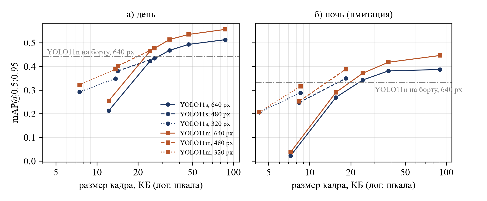
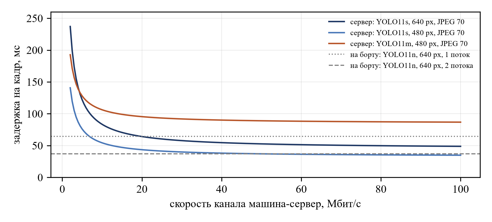

# edge-offload-detection

On-board or roadside server: where should a vehicle run its object detector?

This repository has the code and all raw measurements for the paper by A. Mingazov and A. Andrianova (Kazan Federal University, 2026). We compare a light YOLO model on a weak on-board computer with a heavier model on an edge server that receives a JPEG-compressed frame. Both daylight and simulated low light are tested.

## Setup
- Data: the first 500 COCO val2017 images that contain a person or a car (1921 people, 294 cars). mAP@0.5:0.95 is computed for these two classes only.
- Low light: the image goes to linear light, brightness is multiplied by 0.12 (about 3 stops), then signal-dependent Poisson-Gaussian noise is added. Fixed seed.
- Transmitted frame: longer side 640, 480 or 320 px, JPEG quality 10 to 90 (OpenCV).
- Models: YOLO11n, YOLOv8n, YOLO11s and YOLO11m (Ultralytics 8.4, COCO weights, no fine-tuning).
- Hardware: AMD Ryzen 9 7940HS, 32 GB RAM, PyTorch 2.15 on CPU only. The on-board computer is emulated with 1 or 2 threads, the server with 8.
- Latency: median full pipeline time per frame over 100 frames, after 10 warm-up frames. Offloading latency = encode + size / bandwidth + decode + server inference. Radio access delay and packet loss are not modelled.

## Main results

| | Day | Night (simulated) |
|---|---|---|
| YOLO11n on board, 640 px, raw frame | 0.441 | 0.332 |
| YOLO11s on server, 640 px, JPEG 70 (about 47 / 38 KB) | 0.493 | 0.381 |
| YOLO11m on server, 640 px, raw frame (upper bound) | 0.563 | 0.457 |

- Low light reduces accuracy of every model by 19-26 %.
- Night frames are much more sensitive to JPEG: at quality 30, YOLO11m loses 17 % in daylight and 36 % at night. At quality 10 night detection collapses (mAP 0.038).
- At night, a smaller frame with good JPEG quality is better than a large frame with poor quality: 320 px at quality 70 (8.6 KB) gives 0.316, while 640 px at quality 10 (7.3 KB) gives 0.038.
- Server YOLO11s (8 threads) plus transmission is not slower than on-board YOLO11n with one thread when the uplink provides about 20 Mbit/s in daylight and 16 Mbit/s at night. An on-board computer with two threads is always faster in this configuration.
- One 8-thread CPU server runs YOLO11s at about 23 frames per second, which is only two vehicles at 10 fps. A single roadside computer without an accelerator is not enough.




## Files
- `prep.py`: selects the images, builds the low-light copies and all JPEG variants, records sizes and encode / decode times.
- `run_acc.py`: mAP for every model and variant (48 runs), results in `results/acc.json`.
- `run_time.py <threads>`: latency for every model and input size, results in `results/time.json`.
- `analyze.py`: tables, break-even bandwidth, figures; `results/summary.json`.
- `results/frames.json`: average transmitted size and encode / decode time for every variant.

## Run
```
pip install -r requirements.txt
# download yolo11n.pt, yolov8n.pt, yolo11s.pt, yolo11m.pt from the Ultralytics releases into this folder
python prep.py
python run_acc.py
for t in 1 2 4 8; do python run_time.py $t; done
python analyze.py
```

## Limitations
Night is simulated and COCO is not a driving dataset, so the numbers are useful for comparing configurations, not as absolute values for a car. The next step is real night driving data (BDD100K, ExDark), 4G/5G latency traces and cooperation between several vehicles and roadside units.
